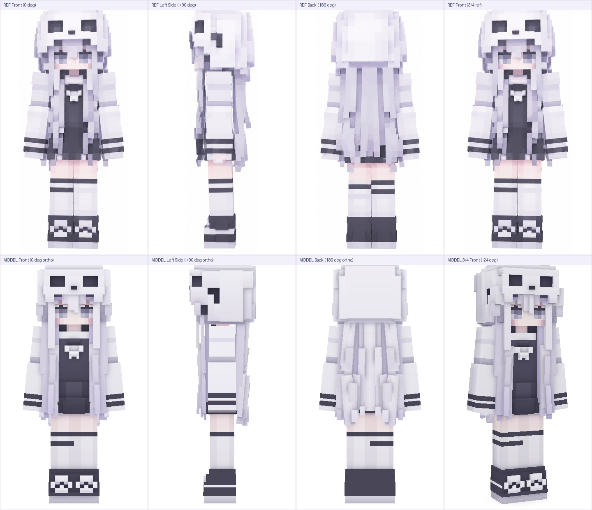
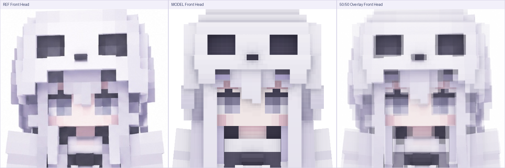
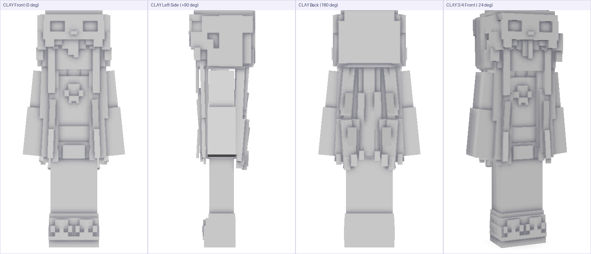
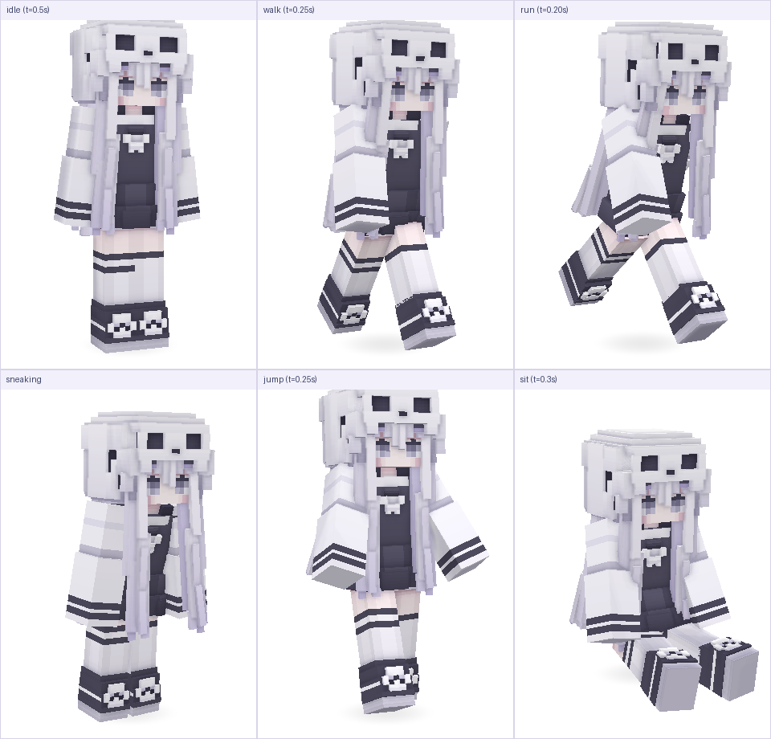

# YSM AI Engine — 专为 AI Agent 打造的《我的世界》YSM 模型程序化建模、SSAO 软渲染与合规校验引擎

[](LICENSE)
[](https://www.python.org/)
[](#%E4%B8%89ysm-260-%E5%90%88%E8%A7%84%E6%A0%A1%E9%AA%8C)

**YSM AI Engine** 是一套面向 AI 编程助手（Antigravity、Claude Code、Cursor、Codex 等）及程序化建模工作流的开源 **Minecraft Yes Steve Model (YSM)** 研发框架。  
它让 AI 无需打开 Blockbench 图形界面，即可通过纯 Python 代码完成**「三视图精确量尺 → 程序化体素建模与 UV 自动装箱 → 离线 SSAO 三视图/50-50 叠图自检 → YSM 2.6.0 零报错校验 → 一键打包 `.zip` 与 `.bbmodel`」**全链路生产。

---

## 效果展示（内置完整示例：`examples/skull_hoodie_girl`）

以下效果图完全由本引擎从零程序化生成，并使用内置 **切平面修正 SSAO 软渲染器** 离线出图对比验证：

### 1. 正 / 左正侧 / 背正交三视图 & 3/4 视角对比


### 2. 50/50 叠图精准对齐校验（`ysm-render overlay`）


### 3. 纯白模 SSAO 体块厚度自检 & 动画姿态检验
| 纯白模 SSAO（体块与层次检查） | 基础动作绑定实拍（`idle / walk / run / sneaking / jump / sit`） |
| :---: | :---: |
|  |  |

---

## 一、核心特性

1. **程序化几何与整数 UV 自动装箱（`ysm_engine.builder`）**
   * 内置 Bedrock `1.12.0` 骨骼树构建、X=0 自动对称镜像（`add_mirrored_cube`，自动翻转旋转符号与 `east/west` 贴图）、纯色/渐变/像素绘制回调（`face_painter`）。
   * 采用 `ShelfPacker` 自动将每个面按像素尺寸装箱到 `512×512`（或自定义尺寸）RGBA 图集，严格生成**零重叠、非零整数 per-face UV**，天然符合 YSM 2.6.0 UV 规范。
   * 一键从全身模型提取第一人称手臂 `models/arm.json`（自动解除父级并将根节点旋转归零）。

2. **带切平面 SSAO 的 3D 软渲染检验器（`ysm_engine.renderer`）**
   * 纯 NumPy + PIL 实现，无需启动 Minecraft、无需 GPU/OpenGL 上下文即可高速渲染：
     * **三点棚拍柔光 + 切平面修正 SSAO（环境光遮蔽）**：让白底白块与多层发片在正交、透视和白模下呈现清晰的立体深浅关系；
     * **自动包围盒定焦**：支持任意身高角色（Q 版或高挑体型），自动对齐正/侧/背正交三视图；
     * **`50/50` 叠图对齐校验（`render_overlay_compare`）**：将参考图与模型正交渲染以相同比例尺同框半透明叠加，方便 AI 对齐五官、帽型和发片轮廓；
     * 支持 Molang 表达式与关键帧求值，批量渲染动作姿态（`render_poses`）和骨骼枢轴图（`render_skeleton_pivots`）。

3. **通用参考图定量分析器（`ysm_engine.analyze_ref`）**
   * 自动切分 1/2/3 视图设定图、统一脚底到头顶像素标尺、提取主色调色板，并导出 Bedrock 单位网格标尺图（`ref_ruler.png`）与轮廓宽度/深度测量数据（`ref_analysis.json`）。

4. **YSM 2.6.0 严格校验 & 一键双格式交付（`validate` / `export_bbmodel` / `package`）**
   * 自动检查 UTF-8 无 BOM 编码、`ysm.json` `spec=2`、文件路径精确大小写、整数非零 UV、18 项核心骨骼与 Locator 嵌套、`arm.json` 规范以及 `main.animation.json` 的 29 个必备基础动作。
   * 校验 0 错误后一键输出游戏直接可用的 `.zip` 安装包，以及内嵌贴图与动画的 Blockbench `.bbmodel` 二次编辑工程。

5. **专为 AI Agent 编写的标准协作规范（`prompts/`）**
   * 附带 `prompts/AGENT_GUIDE.md` 与 `prompts/SKILL.md`，让 AI Agent 直接掌握 Bedrock 旋转正负号、独立眼部图层、分层片状发丝、4 阶段自检迭代流程。

---

## 二、仓库目录结构

```text
ysm-ai-engine/
├── README.md                          # 本文档
├── LICENSE                            # MIT 开源协议
├── pyproject.toml                     # 包配置与 CLI 入口 (ysm-analyze / ysm-render / ysm-validate / ysm-package)
├── requirements.txt                   # 运行依赖 (numpy, pillow)
│
├── ysm_engine/                        # 核心引擎包（支持 pip 安装，也支持直接复制文件夹到新项目）
│   ├── __init__.py
│   ├── builder.py                     # YSMModel, ShelfPacker, 像素绘图工具, arm.json 提取
│   ├── renderer.py                    # BedrockScene, 切平面 SSAO, 三视图/白模/50-50 叠图/动作/骨骼渲染
│   ├── analyze_ref.py                 # 参考三视图自动裁切、像素标尺与色板测量
│   ├── validate.py                    # YSM 2.5 / 2.6.0 合规校验器
│   ├── export_bbmodel.py              # Blockbench .bbmodel 导出器
│   └── package.py                     # 校验 + .zip / .bbmodel 打包器
│
├── prompts/                           # AI Agent 上下文规范与 Skill 模板
│   ├── AGENT_GUIDE.md                 # AI 建模 SOP、Bedrock 坐标系与 YSM 2.6.0 硬性规范
│   └── SKILL.md                       # 可直接导入 Antigravity / Claude Code / Cursor 的 Skill 文件
│
├── examples/                          # 完整可复现示例工程
│   └── skull_hoodie_girl/
│       ├── reference/reference_3view.jpg
│       ├── build_model.py             # 28 根骨骼、169 个体素、独立 3×2 眼部图层与片状长发建模源码
│       ├── build_animations.py        # 29 个基础动作、arm 动画与 ysm.json 清单生成
│       └── run_all.py                 # 一键复现示例全部渲染、校验与打包产物
│
├── docs/showcase/                     # README 展示效果图
└── tests/                             # 自动化全链路回归测试
    └── test_pipeline.py
```

---

## 三、安装方法

环境要求：**Python 3.9+**（依赖仅需 `numpy` 和 `pillow`）。

### 方式 A：可编辑安装（推荐，全局使用 CLI 与 Python 包）

```bash
git clone https://github.com/chenx5452321/ysm-ai-engine.git
cd ysm-ai-engine
pip install -e .
```

安装后即可在任意项目目录下直接使用以下 5 个命令：
* `ysm-analyze` —— 分析参考图并生成标尺
* `ysm-render` —— 渲染三视图对比、白模、特写、50/50 叠图、动作与骨骼枢轴
* `ysm-validate` —— 执行 YSM 2.6.0 合规校验
* `ysm-package` —— 校验并打包 `.zip` 与 `.bbmodel`
* `ysm-export-bbmodel` —— 单独将 `main.json` + 贴图 + 动画转为 `.bbmodel`

### 方式 B：零安装即拷即用（Portable 模式）

如果你不想安装包，只需：
1. 安装两个基础依赖：`pip install -r requirements.txt`
2. 将整个 `ysm_engine/` 文件夹直接复制到你的新模型项目根目录下；
3. 在脚本中直接 `from ysm_engine import YSMModel, ...`，并通过 `python -m ysm_engine.validate ...` 调用工具即可。

---

## 四、快速上手

### 1. 一键运行内置完整示例

```bash
python examples/skull_hoodie_girl/run_all.py
```

运行完成后，会在 `examples/skull_hoodie_girl/out/` 生成：
* `skull_hoodie_girl/` —— 已解包的 YSM 模型文件夹
* `skull_hoodie_girl.zip` —— 可直接放入游戏加载的模型压缩包
* `skull_hoodie_girl.bbmodel` —— 可在 Blockbench 打开编辑的工程文件

并在 `examples/skull_hoodie_girl/renders/` 生成全套自检对比图。

### 2. 运行自动化测试

```bash
python -m unittest discover -s tests -v
```

---

## 五、使用指南（Python API & 命令行全流程）

### 第 1 步：分析参考三视图

```bash
ysm-analyze path/to/character_3view.jpg -o reference --height 34.0
```
输出 `reference/crops/ref_front.png`、`ref_side.png`、`ref_back.png`、`reference/ref_ruler.png`（带 Bedrock 单位刻度线）及 `reference/ref_analysis.json`。

### 第 2 步：编写 Python 建模脚本

```python
from ysm_engine import YSMModel, make_vgradient_patch, lerp_color, parse_color

m = YSMModel(identifier="geometry.model", texture_width=512, texture_height=512, texels_per_unit=3.0)

# 1. 建立 YSM 2.6.0 标准骨骼层级
m.add_bone("All", pivot=(0, 0, 0))
m.add_bone("Waist", parent="All", pivot=(0, 12, 0))
m.add_bone("Body", parent="Waist", pivot=(0, 12, 0))
m.add_bone("AllHead", parent="Body", pivot=(0, 24, 0))
m.add_bone("Head", parent="AllHead", pivot=(0, 24, 0))
m.add_bone("ViewLocator", parent="Head", pivot=(0, 28, 0))
# ... 补全 RightArm/LeftArm/Hand/Locator 与 RightLeg/LeftLeg 等 18 项必选骨骼

# 2. 构建体素与自动对称镜像，并自动装箱 UV
m.add_cube("Head", origin=(-3.5, 24.0, -3.5), size=(7.0, 7.0, 7.0), solid_color="#FCF1F2")
m.add_mirrored_cube(
    "RightArm", "LeftArm",
    origin=(-6.0, 13.0, -1.8), size=(3.2, 11.0, 3.6),
    vgradient=("#F5F3FA", "#DCD8EA"),
)

# 3. 导出主几何、第一人称手臂与打包贴图
m.export_main_json("dist/my_girl/models/main.json")
m.export_arm_json("dist/my_girl/models/arm.json")
m.export_texture("dist/my_girl/textures/default.png")
```

> 更多高阶技巧（独立眼部图层 `EyeRight/EyeLeft`、定制 `face_painter` 像素画、片状多层头发与立体像素饰品）可参考 [examples/skull_hoodie_girl/build_model.py](examples/skull_hoodie_girl/build_model.py)。

### 第 3 步：离线 SSAO 渲染与视觉自检

```bash
# 纯白模 SSAO 体块检查
ysm-render clay dist/my_girl/models/main.json dist/my_girl/textures/default.png -o renders/clay.png

# 正交三视图 + 3/4 透视对比
ysm-render turnaround dist/my_girl/models/main.json dist/my_girl/textures/default.png --crops reference/crops -o renders/turnaround.png

# 50/50 叠图精准对齐（分别检验正面、正侧、背面）
ysm-render overlay dist/my_girl/models/main.json dist/my_girl/textures/default.png reference/crops/ref_front.png -o renders/ov_front.png --yaw 0 --ymin 22 --ymax 34.6
ysm-render overlay dist/my_girl/models/main.json dist/my_girl/textures/default.png reference/crops/ref_side.png  -o renders/ov_side.png  --yaw 90 --ymin 10.5 --ymax 34.5
ysm-render overlay dist/my_girl/models/main.json dist/my_girl/textures/default.png reference/crops/ref_back.png  -o renders/ov_back.png  --yaw 180 --ymin 10.5 --ymax 34.5

# 5 视角细节特写 & 动作姿态 & 骨骼枢轴检查
ysm-render closeups dist/my_girl/models/main.json dist/my_girl/textures/default.png --crops reference/crops -o renders/closeups.png
ysm-render poses    dist/my_girl/models/main.json dist/my_girl/textures/default.png dist/my_girl/animations/main.animation.json -o renders/poses.png
ysm-render skeleton dist/my_girl/models/main.json dist/my_girl/textures/default.png -o renders/skeleton.png
```

### 第 4 步：YSM 2.6.0 合规校验与打包

```bash
# 严格校验（必须 0 errors）
ysm-validate dist/my_girl

# 打包为可导入游戏的 .zip 与可编辑的 .bbmodel
ysm-package dist/my_girl
```

---

## 六、如何配合 AI Agent 使用本引擎

1. 把本仓库设为工作区，或在你的 AI Agent（Antigravity / Claude Code / Cursor 等）提示词中要求它**先阅读 `prompts/AGENT_GUIDE.md`**。
2. 也可以直接将 `prompts/SKILL.md` 复制到你的 `.agent/skills/ysm-procedural-modeling/SKILL.md` 或 `.claude/skills/` 目录。
3. 发送角色设定图或三视图给 AI，即可让它自动按 **4 阶段闭环流程**（量尺 → 白模 → 50/50 叠图精雕 → 动画校验打包）高还原度完成角色。

---

## 七、在 Minecraft 中安装生成的模型

1. 确保客户端已安装 **Yes Steve Model (YSM 2.5 / 2.6.x)** 模组；
2. 将打包好的 `*.zip`（或解压后的模型文件夹）放入 `.minecraft/config/yes_steve_model/custom/`；
3. 进入游戏执行 `/ysm model reload`，按 `Alt + Y` 即可切换使用；
4. 如需手动微调，直接用 **Blockbench 4.x / 5.x** 打开同目录下生成的 `*.bbmodel`。

---

## License

本项目基于 [MIT License](LICENSE) 开源。
